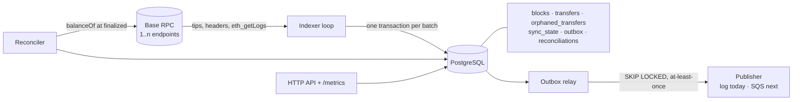
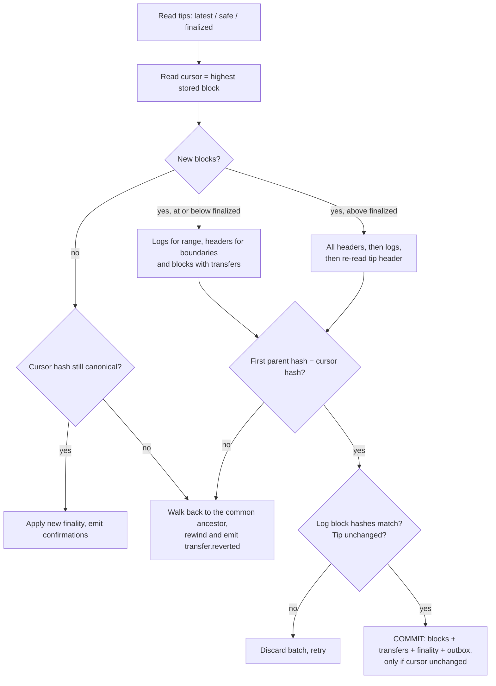

# Base USDC Indexer


[](https://codespaces.new/BrianLiu0531/base-usdc-indexer?quickstart=1)

A Go service that watches USDC `Transfer` events on [Base](https://base.org) for a set of addresses — the deposit-detection problem an exchange or wallet has — and records each transfer **exactly once**, follows it from *pending* to *finalized*, survives **chain reorganisations**, RPC outages and crashes, and **reconciles** its numbers against `balanceOf` on chain.

Downstream systems get a `transfer.confirmed` event through a **transactional outbox** once a transfer reaches the configured finality, and a compensating `transfer.reverted` event if a reorg ever removes a transfer that was already announced.

**Stack:** Go · go-ethereum · PostgreSQL (pgx) · Prometheus · Docker · GitHub Actions

## Why this is harder than `eth_getLogs` in a loop

| Problem | What goes wrong naïvely | What this indexer does |
|---|---|---|
| **Reorgs** | The latest blocks can be replaced. Transfers from orphaned blocks stay in the database and get credited. | Stores every unfinalized block hash and checks each new block's `parentHash` against the cursor. On a mismatch it walks back to the common ancestor and rewinds in one transaction, moving orphaned transfers to an audit table. |
| **Finality** | "N confirmations" is a guess, and the guess differs per chain. | Uses the OP Stack's `safe` and `finalized` block tags. Each transfer moves `pending → safe → finalized`, and you choose the level that triggers crediting. |
| **Duplicates** | Retries, restarts or two instances write the same log twice. "Check whether it exists, then insert" races. | `UNIQUE (chain_id, tx_hash, log_index)` with `ON CONFLICT DO NOTHING`. The batch, cursor and outbox events commit in **one transaction**, and that transaction refuses to commit if the cursor moved (optimistic check + advisory lock). |
| **Mid-fetch changes** | The node reorgs between reading headers and reading logs, so you store one fork's hashes with another fork's logs. | Every log's `blockHash` must match the stored header, and the batch tip is re-read after the logs. Any difference aborts the batch and retries it. |
| **Inconsistent nodes** | Behind a load balancer, each request can hit a different node. A lagging node returns logs only up to its own head, which drops data silently, or appears to "lose" blocks, which triggers a false reorg. | The node that serves `eth_getLogs` must report a head at or above the range end. A node behind the cursor is waited for: a rewind needs a hash mismatch as proof. |
| **Provider limits** | `eth_getLogs` errors such as "limited to a 200 range" or "more than 10000 results" stall the sync. | Halves the range on a range error, learns the provider's ceiling, and grows back after successes. Rate limiting counts each JSON-RPC batch element. Retries use exponential backoff with jitter and fail over across RPC URLs. |
| **Silent drift** | A missed log goes unnoticed. | Every 5 minutes it checks `balanceOf(address, finalizedBlock)` against the opening balance plus indexed net flow, and alerts on any difference. |

All 42 edge cases considered, from address-poisoning spam to concurrent writers, are listed with their status and tests in **[docs/edge-cases.md](docs/edge-cases.md)**.

These are lessons from building a gaming wallet in a previous role, where settlement callbacks were deduplicated with a read-then-write check and balances were checked before being decremented. Both are race conditions under concurrency. Here the database enforces uniqueness, and every state change is atomic.

## Architecture



### One indexing step



Blocks at or below `finalized` cannot reorg, so the backfill fetches only boundary headers and needs few RPC calls. Above `finalized`, every header is stored so a reorg of any depth can be traced back exactly. A reorg reaching below `finalized` would mean the node disagrees with data already treated as final. The indexer refuses to touch that data, logs an error, and keeps retrying. It never deletes it.

## Guarantees

- **No duplicates:** at most one row per `(chain, tx_hash, log_index)`, enforced by the database.
- **No gaps:** the cursor only advances in the same transaction that writes the batch.
- **Consistency:** after any sequence of reorgs, failures and restarts, the database holds exactly the canonical chain's watched transfers. A randomised simulation tests this (see below).
- **Events:** each `transfer.confirmed` has a deterministic `eventId`. Delivery is at-least-once and consumers deduplicate on `eventId`. Replaying the outbox (confirmed minus reverted) credits each canonical transfer exactly once.

## API

| Endpoint | Description |
|---|---|
| `GET /` | Live dashboard: sync progress, balances, reconciliation and recent transfers per watched address |
| `GET /v1/status` | Chain heights, indexed block, lag, watched addresses |
| `GET /v1/addresses/{address}` | Finalized totals, indexed balance and the last reconciliation result |
| `GET /v1/addresses/{address}/transfers?limit=25&before=<block>:<logIndex>` | Transfers newest first, with direction, amount, status and keyset pagination |
| `GET /metrics` | Prometheus metrics: chain heights, indexed block, reorgs and depth, RPC errors and latency, reconciliation mismatches |
| `GET /healthz` | Liveness |

<details>
<summary>Example output from Base Sepolia</summary>

```json
GET /v1/addresses/0x2E78bcdCbF7ba1ADc2252819d6134d6549960f3A
{
  "address": "0x2E78bcdCbF7ba1ADc2252819d6134d6549960f3A",
  "finalized": { "received": { "raw": "492500", "usdc": "0.4925" }, "sent": { "raw": "0", "usdc": "0" }, "count": 197 },
  "indexedBalance": { "raw": "3947478600", "usdc": "3947.4786" },
  "lastReconciliation": {
    "block": 50730302, "ok": true,
    "onchain":  { "raw": "3947478600", "usdc": "3947.4786" },
    "expected": { "raw": "3947478600", "usdc": "3947.4786" }
  }
}
```
</details>

## Running it

**In the browser:** click *Open in GitHub Codespaces* above. The database and indexer start automatically (the first build takes a minute or two). Then open the **Ports** tab and click the globe icon next to port 8080 to see the live dashboard. Run the tests with `go test ./...`.

**Locally:**

```bash
cp .env.example .env          # set WATCH_ADDRESSES; RPC_URLS defaults to the public Base Sepolia endpoint
docker compose up --build     # PostgreSQL + indexer; dashboard on http://localhost:8080
```

To run without Docker, start only the database (`docker compose up -d db`), then run `go run ./cmd/indexer` with the variables from `.env` exported.

For mainnet set `NETWORK=base`. Use a provider such as Alchemy or QuickNode, since the public endpoints allow 25 requests/s and 200-block log queries. All settings are documented in [`.env.example`](.env.example).

## Tests

```bash
docker compose up -d db
go test ./...                                                    # 27 tests
SOAK_SEEDS=500 go test -run Randomised ./internal/indexer        # longer simulation
```

- **Indexer** (against real PostgreSQL, with an in-memory chain that can mine, reorg and fail on demand):
  - indexes each watched transfer once, including transfers between two watched addresses
  - resumes after a restart
  - rejects a stale writer
  - emits confirmations once at the configured level
  - replaces orphaned transfers, including a transaction re-mined in a different block
  - detects reorgs that don't lengthen the chain
  - recovers from a reorg in the middle of a fetch
  - learns the provider's log-range limit
  - refuses to rewind finalized data
  - waits for a lagging node instead of rewinding
  - stores zero-value spam transfers without announcing them
  - two indexers writing concurrently never duplicate a row
- **Randomised simulation:** 40 rounds per seed of random mining, reorgs (with transaction re-inclusion), finality changes, 10–30% RPC failure rates and crashes. After every 10 rounds the database must equal the canonical chain, with the right finality per transfer and an outbox that nets to one credit per confirmed transfer. CI runs 100 seeds on every push.
- **RPC client:**
  - range-error detection against real provider messages
  - both-direction log queries and their merge
  - failover between endpoints
  - rejecting logs from a node that hasn't reached the range end
  - API keys never appearing in errors
- **Reconciler, outbox and API** (including detection of a balance change the indexer never saw)

## Project layout

```
cmd/indexer          wiring, graceful shutdown
internal/chain       Client interface, JSON-RPC implementation (batching, retries, failover, rate limit)
internal/chain/chaintest  in-memory chain for tests
internal/indexer     sync loop: batches, reorg detection and rewind
internal/store       PostgreSQL schema, atomic batch writes, outbox, queries
internal/reconcile   balanceOf reconciliation
internal/outbox      outbox relay and publishers
internal/api         HTTP API
```

## Next

- **SQS publisher + Lambda consumer.** The outbox relay publishes to an SQS FIFO queue (message group per transfer). A Go Lambda credits deposits idempotently with DynamoDB conditional writes, using partial batch failure reporting and a dead-letter queue. Infrastructure is in Terraform, deployed from GitHub Actions with OIDC.
- Watch-list changes without re-indexing (per-address start blocks).
